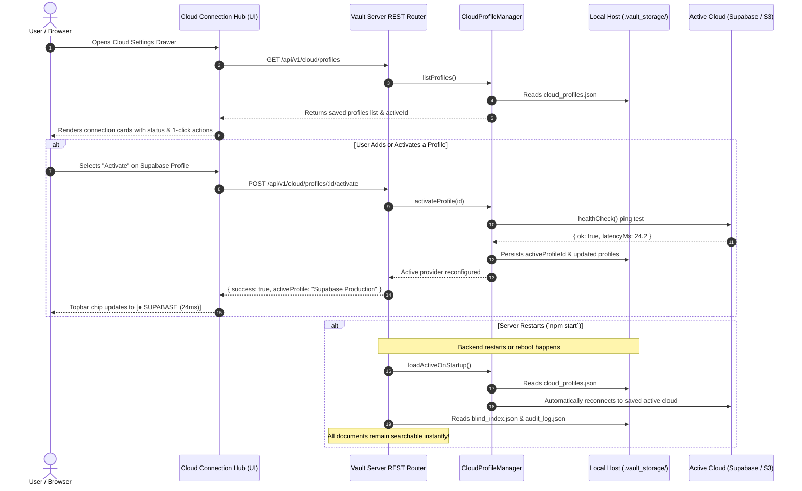

# Phase 15: Multi-Cloud Connection Profiles, Persistent Storage Engine & Search Index Durability

## Executive Summary
In real-world enterprise zero-knowledge storage, organizations operate across multiple cloud providers (e.g., Supabase, AWS S3, Cloudflare R2, MinIO, and Local Offline Disk) and require state durability across server restarts. Currently, restarting the Node backend (`npm start`) resets the active cloud provider back to `memory` and clears the in-memory blind search index and audit log.

Phase 15 transforms the application into an enterprise-grade Multi-Cloud Connection Hub with:
1. **Cloud Profile Manager**: Create, list, edit, test, and 1-click activate multiple named cloud connections (e.g. "Supabase Production", "AWS S3 Archive", "Local Disk Vault") persisted securely in `./.vault_storage/cloud_profiles.json` (git-ignored).
2. **Server Durability Engine**: Auto-persistence of the active cloud provider, the server blind search index (`blind_index.json`), and the server audit chain (`audit_log.json`) across server restarts.
3. **Interactive Cloud Profiles UI**: A modern connection manager in the Cloud Drawer with live status indicators, 1-click activation, credential masking, inline ping testing, and profile editing.
4. **Comprehensive Automated Test Suite**: 100% test coverage for profile CRUD, disk persistence roundtrips, server restart simulations, and UI integration.

---

## Architecture & Data Flow

---

## Detailed Task Breakdown

### Wave 1: Core Profile Manager & Server Durability Engine
- [ ] **Task 1.1: `src/server/cloud/profile_manager.ts`**
  - Define `CloudProfile` interface: `id`, `name`, `provider` (`supabase` | `s3` | `disk` | `memory`), `config`, `isActive`, `createdAt`, `updatedAt`.
  - Implement `CloudProfileManager`:
    - Storage path: `./.vault_storage/cloud_profiles.json`.
    - Auto-seed with default "Local Disk Vault" and "In-Memory Ephemeral" profiles if file doesn't exist.
    - Methods: `listProfiles()`, `getProfile(id)`, `saveProfile(data)`, `activateProfile(id, factory, blobStore)`, `deleteProfile(id)`.
    - Secret masking for client responses (`maskSecrets()`).
- [ ] **Task 1.2: Server State Persistence (`ServerBlindStore` & `auditLogger`)**
  - Add optional disk persistence to `ServerBlindStore` (`./.vault_storage/blind_index.json`): auto-save upon `insertEntries()`, auto-load upon instantiation if storage file exists.
  - Add optional disk persistence to `ZeroKnowledgeAuditLogger` (`./.vault_storage/audit_log.json`): auto-save upon `logOperation()`, auto-load upon instantiation.
- [ ] **Task 1.3: REST Endpoints in `src/server/server_app.ts`**
  - `GET /api/v1/cloud/profiles`: Return all profiles, masked secrets, and active profile ID.
  - `POST /api/v1/cloud/profiles`: Create or update a named profile.
  - `POST /api/v1/cloud/profiles/:id/activate`: Run health check, switch active provider, update persistent state.
  - `DELETE /api/v1/cloud/profiles/:id`: Delete an inactive profile.
  - Integrate startup hydration in `VaultServerApp` constructor to auto-load saved active profile.

### Wave 2: Frontend Cloud Connection Hub
- [ ] **Task 2.1: Semantic HTML Markup (`public/index.html`)**
  - Redesign Cloud Storage Settings modal into:
    - **Header**: Title, subtitle, close button, `+ Add New Cloud` button.
    - **Profiles Container** (`#cloudProfilesList`): Dynamic list of connection cards.
    - **Editor Container** (`#cloudProfileEditor`): Clean form for adding/editing a profile with friendly name, provider type pills/dropdown, credentials inputs, test ping, and save actions.
- [ ] **Task 2.2: Styling (`public/styles.css`)**
  - Style connection cards with luxury swatch palette (Soft Limestone `#F0E6D8`, Deep Rust `#5A2E25`, Terracotta `#B5543A`, Olive `#6F7F5F`).
  - Active profile badge (`● ACTIVE`), latency pill, provider icon, action button bar.
- [ ] **Task 2.3: Frontend Controller (`public/app.js`)**
  - Implement `loadCloudProfiles()`, `renderCloudProfiles()`, `showProfileEditor()`, `handleSaveProfile()`, `handleActivateProfile()`, `handleDeleteProfile()`, `handleTestProfilePing()`.
  - Update topbar cloud chip to reflect active profile name and ping latency.
  - Auto-refresh profiles on drawer open.

### Wave 3: Testing, Verification & Walkthrough
- [ ] **Task 3.1: Unit Tests (`tests/server/cloud_profiles.test.ts`)**
  - Test profile creation, validation, secret masking, activation, deletion, and file persistence across re-instantiation.
- [ ] **Task 3.2: Durability & API Integration Tests (`tests/server/server_app.test.ts` & `cloud_api.test.ts`)**
  - Test `/api/v1/cloud/profiles` CRUD operations.
  - Simulate server restart: write index entries, restart `VaultServerApp`, verify search index and active cloud profile persist.
- [ ] **Task 3.3: Full Regression Run**
  - Run `npm test` to verify all existing and new tests pass (targeting 155+ passing tests, 0 failures).
- [ ] **Task 3.4: Browser Walkthrough Verification**
  - Walk through profile creation, activation of Supabase, ping testing, and switching between providers.

---

## Acceptance Criteria
1. User can create, edit, view, and delete named cloud connection profiles in the UI.
2. User can switch active cloud providers with a single click.
3. Restarting the backend server (`npm start`) retains the active cloud profile and reconnects automatically.
4. Server blind search index and audit log survive server restarts without losing indexed documents.
5. All automated unit and integration tests pass with 100% green status.
